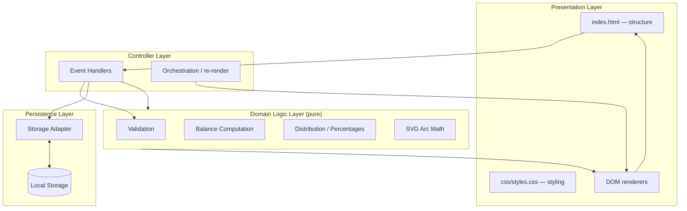

# Design Document

## Overview

The Expense & Budget Visualizer is a single-page, client-side web application for tracking personal expenses. A user enters a transaction (item name, amount, category), views a scrollable list of recorded transactions, sees a running total balance, and inspects a pie chart of spending distribution by category. All data is persisted in the browser's Local Storage, so the application runs without any backend server.

Per the requirements (Requirement 7), the application uses plain HTML for structure, a single CSS file for styling, and a single vanilla JavaScript file for behavior — no front-end framework and no external JavaScript library. This constraint drives the central design decision: the pie chart is rendered with hand-authored SVG arc paths rather than a charting library, and the code is organized into clearly separated pure-logic and side-effect layers within the one permitted JS file so that the core logic remains independently testable.

### Scope

This design covers the application architecture, module decomposition, data models, correctness properties, error handling, and testing strategy. It addresses all nine requirement groups: transaction entry, list display, deletion, total balance, spending distribution chart, data persistence, technology stack, browser compatibility and performance, and interface clarity.

## Research

Three technical areas were researched to inform the design.

**1. Rendering a pie chart without a charting library.** Since no external library is permitted, the pie chart is drawn with SVG `<path>` elements. Each slice is an arc computed from a cumulative angle: a helper converts polar coordinates (center, radius, angle) to Cartesian `(x, y)`, and the path uses the SVG arc command `A rx ry x-axis-rotation large-arc-flag sweep-flag x y`. The `large-arc-flag` is set to `1` for any slice covering 180° or more so the arc draws the longer way around. A slice that equals 100% (a full circle) cannot be represented by a single arc where start equals end, so it is drawn as a full `<circle>` element instead. This approach is well established for pure-JS pie charts ([Stack Overflow: SVG pie chart with pure JS](https://stackoverflow.com/questions/41539287/svg-pie-chart-with-pure-js-no-framework), [Stack Overflow: calculating the percentage for an SVG pie chart](https://stackoverflow.com/questions/66467339/calculating-the-percentage-for-an-svg-pie-chart)).

**2. Floating-point arithmetic for currency.** JavaScript's IEEE 754 doubles produce artifacts such as `0.1 + 0.2 === 0.30000000000000004`, which is unacceptable for displayed balances and percentages. Two safe options exist: perform all monetary arithmetic in integer cents (multiply by 100), or round display values with `Math.round(value * 100) / 100` (two decimals) and `Math.round(value * 10) / 10` (one decimal). The maximum allowed amount is `999,999,999.99`; scaled to cents this is `99,999,999,999`, far below `Number.MAX_SAFE_INTEGER` (`2^53 ≈ 9×10^15`), so integer-cents arithmetic is exact and overflow-safe. The design uses rounded arithmetic for the balance/distribution computations and notes the cents-based alternative as an option ([Stack Overflow: dealing with floating point number precision](https://stackoverflow.com/questions/1458633/how-can-i-deal-with-floating-point-number-precision-in-javascript)).

**3. Local Storage failure modes.** `localStorage.setItem` throws a `QuotaExceededError` when storage limits (typically 5–10 MB) are reached, and may throw in private-browsing modes where storage is unavailable. `getItem` returns `null` when the key is absent and can throw when storage is disabled. Both operations are wrapped in `try/catch`; on failure the application keeps the in-memory transaction set and shows an error message, satisfying Requirements 6.4 and 6.6 ([Stack Overflow: setting the value exceeded the quota](https://stackoverflow.com/questions/23977690/setting-the-value-of-dataurl-exceeded-the-quota)).

## Architecture

The application follows a layered architecture that separates pure domain logic from side effects. This separation is the key design decision: it keeps the validation, balance, and distribution logic free of DOM and storage dependencies so they can be unit-tested and property-tested in isolation, while a thin controller layer owns all side effects (DOM rendering, event handling, Local Storage I/O).

All behavior lives in the single permitted JavaScript file (`js/app.js`). Internally it is organized into module objects/namespaces that mirror the layers below. No build step or bundler is used; the modules are plain objects attached to the file scope.



### Layer responsibilities

- **Presentation Layer** — `index.html` provides the static page skeleton (input form, balance header, transaction list container, chart container). `css/styles.css` styles all components and provides the single-page layout. DOM renderers produce and update the dynamic parts (list rows, balance figure, SVG chart).
- **Controller Layer** — wires user events (form submit, delete click, confirm/cancel) to the domain and persistence layers, then triggers a re-render. It is the only layer that touches both the DOM and the pure logic, keeping the pure logic ignorant of the UI.
- **Domain Logic Layer** — pure functions with no side effects: input validation, total-balance computation, category distribution and percentage calculation, and SVG arc path math. These are the primary targets for property-based testing.
- **Persistence Layer** — a thin storage adapter that serializes the transaction array to JSON, reads/writes Local Storage, and reports success/failure without throwing to the caller.

### Data flow

1. User submits the input form → controller calls `validateTransaction`.
2. On valid input, controller calls `addTransaction` (updates in-memory state), then `saveTransactions` (persist to Local Storage).
3. Controller calls `computeTotalBalance` and `computeDistribution`, then re-renders the balance, list, and chart.
4. User deletes a transaction → controller shows confirmation → on confirm, removes from state, persists, re-renders.
5. On page load, controller calls `loadTransactions` (read Local Storage), populates state, and renders balance, list, and chart.

## Components and Interfaces

The single JavaScript file exposes the following module contracts. Function signatures use plain JSDoc-style types. Pure functions (no DOM/storage access) are marked `[pure]`.

### Validation Module `[pure]`

```js
// Validates a raw form input object against the transaction rules.
// Returns a result with a list of field-specific error messages.
validateTransaction(input: { item: string, amount: string, category: string })
  -> { valid: boolean, errors: string[] }

// True when amount is a finite, positive number <= 999,999,999.99
// with at most 2 decimal places.
isValidAmount(value: string | number) -> boolean

// True when item is a string of length 1..100 (after trim) and non-empty.
isValidItemName(value: string) -> boolean
```

### State Module

The in-memory single source of truth for the current transaction list.

```js
getTransactions() -> Transaction[]
addTransaction(input) -> Transaction        // assigns id; mutates state
deleteTransaction(id: string) -> Transaction[]  // mutates state
```

### Balance Module `[pure]`

```js
// Sum of all transaction amounts, rounded to 2 decimal places.
// Returns 0 for an empty list.
computeTotalBalance(transactions: Transaction[]) -> number
```

### Distribution Module `[pure]`

```js
// Groups transactions by category, summing amounts per category,
// and computing each category's percentage of the grand total,
// rounded to 1 decimal place. Transactions with no/unknown category
// are grouped under "Uncategorized". Returns [] for an empty list.
computeDistribution(transactions: Transaction[])
  -> Segment[]   // { category: string, total: number, percentage: number }
```

### Chart Module

```js
// Pure geometry helper: Cartesian point for a given angle (degrees from top).
polarToCartesian(cx, cy, r, angleDeg) -> { x: number, y: number }   // [pure]

// Pure geometry helper: SVG path data string for a single slice.
describeArc(cx, cy, r, startAngle, endAngle) -> string              // [pure]

// Builds and returns an SVG element representing the pie chart.
// A 100% slice is drawn as a full circle. Empty input returns null.
buildPieChartSVG(segments: Segment[]) -> SVGElement | null
```

### Storage Adapter

```js
// Persists the transaction array to Local Storage as JSON.
// Never throws; returns an ok/error result.
saveTransactions(transactions: Transaction[]) -> { ok: boolean, error?: string }

// Reads and parses the transaction array from Local Storage.
// Missing key returns ok with []. Parse/storage failure returns ok:false.
loadTransactions() -> { ok: boolean, transactions: Transaction[], error?: string }
```

### View/Controller

```js
// Full re-render of balance, list, and chart from current state.
renderAll() -> void

// Renders/refreshes the transaction list rows (with delete controls).
renderTransactionList(transactions: Transaction[]) -> void

// Renders the balance figure formatted to 2 decimals.
renderBalance(amount: number) -> void

// Renders the pie chart or the empty-state message.
renderChart(transactions: Transaction[]) -> void

// Attaches all event listeners (form submit, delete, confirm dialog).
attachEventListeners() -> void

// Application entry point: loads persisted data and renders initial view.
init() -> void
```

## Data Models

### Transaction

A single recorded expense entry. The `id` uniquely identifies a transaction for deletion and is generated on creation.

```ts
interface Transaction {
  id: string;          // unique id, e.g. crypto.randomUUID() or timestamp+random
  item: string;        // 1..100 characters, non-empty after trim
  amount: number;       // positive, <= 999,999,999.99, at most 2 decimal places
  category: string;    // "Food" | "Transport" | "Fun" | "Uncategorized"
}
```

The `category` value is one of the three selectable options for transactions entered through the form. `"Uncategorized"` is a synthetic fallback used only when rendering the chart for transactions that somehow lack a recognized category (Requirement 5.4), e.g. legacy or externally-imported data; it is never produced by the validated input form.

### ValidationResult

Result of validating a raw input form object.

```ts
interface ValidationResult {
  valid: boolean;       // true iff errors is empty
  errors: string[];     // human-readable, field-specific messages
}
```

### Segment

A single pie-chart slice produced by the distribution computation.

```ts
interface Segment {
  category: string;    // category name, or "Uncategorized"
  total: number;        // sum of that category's amounts, 2 decimals
  percentage: number;    // share of grand total, 0..100, 1 decimal place
}
```

### StorageResult

Result envelope returned by the storage adapter so callers never handle thrown exceptions.

```ts
interface StorageResult {
  ok: boolean;                // true on success
  transactions?: Transaction[]; // present on successful load
  error?: string;              // present on failure
}
```

### Local Storage schema

- **Key:** `expense-visualizer:transactions`
- **Value:** a JSON array of `Transaction` objects, e.g.:
  ```json
  [
    { "id": "a1b2", "item": "Lunch", "amount": 12.5, "category": "Food" },
    { "id": "c3d4", "item": "Bus fare", "amount": 3.0, "category": "Transport" }
  ]
  ```
- Amounts are stored as numbers (JSON numbers). Because JSON round-trips numbers losslessly for these magnitudes and the values are validated to at most 2 decimals before storage, parsing restores equivalent values (Requirement 6.3).

## Correctness Properties


*A property is a characteristic or behavior that should hold true across all valid executions of a system—essentially, a formal statement about what the system should do. Properties serve as the bridge between human-readable specifications and machine-verifiable correctness guarantees.*

The properties below target the pure domain-logic layer (validation, balance, distribution, deletion state, and serialization). They are implementable as fast-check property tests with a minimum of 100 iterations each, using arbitraries that generate valid and invalid transactions and lists. UI and persistence side effects are covered by the example/integration tests in the Testing Strategy and are not expressed as properties.

### Property 1: Valid transaction is accepted

*For any* input with a non-empty item name of 1–100 characters, a positive amount not exceeding `999,999,999.99` with at most 2 decimal places, and a category of Food, Transport, or Fun, `validateTransaction` SHALL return `{ valid: true }` and the transaction SHALL be added to the list.

**Validates: Requirements 1.3**

### Property 2: Empty or whitespace-only fields are rejected

*For any* input where at least one of item, amount, or category is empty or composed entirely of whitespace, `validateTransaction` SHALL reject the submission and the returned errors SHALL name the empty field(s).

**Validates: Requirements 1.4**

### Property 3: Invalid amount is rejected

*For any* amount that is not a finite positive number, that exceeds `999,999,999.99`, or that has more than 2 decimal places, `validateTransaction` SHALL reject the submission with an amount-related message.

**Validates: Requirements 1.5**

### Property 4: Item name length boundary is enforced

*For any* item name longer than 100 characters, `validateTransaction` SHALL reject the submission with a too-long message; and *for any* item name of 1–100 characters (all other fields valid), the submission SHALL be accepted.

**Validates: Requirements 1.7, 1.3**

### Property 5: Transaction list preserves insertion order

*For any* sequence of recorded transactions, the Transaction List SHALL display them in the order they were recorded, so that the list equals the sequence of additions.

**Validates: Requirements 2.1**

### Property 6: Deletion removes exactly the chosen transaction

*For any* transaction list and any transaction id present in that list, deleting that id SHALL remove exactly that one transaction and leave all other transactions present in their original relative order.

**Validates: Requirements 3.3**

### Property 7: Total balance equals the sum of amounts, empty equals zero

*For any* list of transactions, the Total Balance SHALL equal the arithmetic sum of the transaction amounts rounded to 2 decimal places; and *for any* empty list, the Total Balance SHALL equal zero.

**Validates: Requirements 4.1, 4.3**

### Property 8: Category distribution sums to 100 and matches per-category totals

*For any* non-empty list of transactions, the distribution SHALL contain one segment per category present, each segment's percentage SHALL equal `categoryTotal / grandTotal * 100` rounded to 1 decimal place, and the segment percentages SHALL sum to 100 within rounding tolerance.

**Validates: Requirements 5.1**

### Property 9: Missing category is grouped under "Uncategorized"

*For any* transaction whose category is empty, whitespace-only, or not one of Food, Transport, or Fun, the distribution SHALL include those amounts under an "Uncategorized" segment.

**Validates: Requirements 5.4**

### Property 10: Serialization round trip preserves transactions

*For any* list of valid transactions, serializing the list to JSON and parsing it back SHALL restore an equivalent list where each transaction matches by item name, amount, and category.

**Validates: Requirements 6.3**

## Error Handling

Errors are handled gracefully so the application never silently loses in-memory data and always shows the user a clear message.

**Input validation (Requirements 1.4, 1.5, 1.7).** The `validateTransaction` function returns field-specific messages for: empty item/amount/category, amount that is not a positive number within the allowed range with at most 2 decimal places, and item names exceeding 100 characters. On rejection, the entered values are retained in the form and the messages are displayed near the form. Validation is purely a function of the input, so it is fully testable.

**Deletion errors (Requirement 3.5).** If removing a transaction or persisting the change fails, the transaction is retained in the list and an error message is shown.

**Persistence write failure (Requirement 6.4).** `saveTransactions` wraps `localStorage.setItem` in `try/catch`. On `QuotaExceededError` or any thrown exception it returns `{ ok: false, error }`. The controller keeps the current in-memory transactions in the list and shows an error message; the UI state is otherwise unchanged.

**Persistence load failure (Requirement 6.6).** `loadTransactions` wraps `localStorage.getItem` and `JSON.parse` in `try/catch`. If the key is missing, it returns an empty list (Requirement 6.5). If parsing or storage access throws, it returns `{ ok: false }` and the controller renders an empty list, a zero balance, and the empty-state pie chart.

**Floating-point display artifacts.** All displayed monetary values are rounded: balance to 2 decimals, percentages to 1 decimal. This prevents artifacts like `0.30000000000000004` from reaching the user.

**Empty states.** When no transactions exist, the list is empty, the balance shows `0.00`, and the chart shows an empty-state message ("No spending data available") instead of an empty SVG (Requirements 4.3, 5.3, 6.5).

## Testing Strategy

The feature mixes pure domain logic with UI and storage side effects, so the strategy combines property-based tests for the pure layer with example-based unit and integration tests for the side-effect layer.

### Property-based testing (pure domain logic)

Property-based testing applies to this feature because the core logic — validation, balance summation, distribution/percentage calculation, and serialization — consists of pure functions with clear input/output behavior and large, meaningful input spaces. The library used is [fast-check](https://github.com/dubzzz/fast-check), a property-based testing library for JavaScript that requires no framework.

Each property test:
- Runs a minimum of 100 iterations (configured via `fast-check`).
- Is tagged with a comment referencing its design property in the format: `Feature: expense-budget-visualizer, Property {n}: {property text}`.
- Implements a single property from the Correctness Properties section.

Generators (fast-check arbitraries) will produce:
- Valid item names (1–100 printable characters, optionally including whitespace edge cases).
- Valid amounts (positive numbers ≤ `999,999,999.99` with ≤ 2 decimals), represented as both strings and numbers.
- Categories drawn from `Food | Transport | Fun`.
- Lists of valid transactions of varying length (including empty and large lists).
- Deliberately invalid inputs (negative/zero amounts, amounts with > 2 decimals, amounts above the cap, empty fields, names over 100 characters, missing categories).

### Unit tests (examples and edge cases)

Example-based unit tests cover specific scenarios and integration points not suited to properties:
- Form submission adds a transaction and clears the form (Requirement 1.6).
- Transaction list renders item name, amount, and category in recorded order; empty list shows nothing (Requirements 2.1–2.4).
- Delete control appears per row; confirm removes the row, cancel retains it (Requirements 3.1–3.4).
- Balance updates and is formatted to 2 decimals; empty shows `0.00` (Requirements 4.1–4.3).
- Chart renders segments with labels, updates after add/delete, shows empty-state message when empty, and groups missing category under "Uncategorized" (Requirements 5.1–5.4).
- A 100%-single-category slice renders as a full circle (arc edge case).

### Integration tests (side-effect layer)

Integration tests verify the persistence and UI wiring with representative examples:
- Save then reload round-trips transactions and restores identical item/amount/category (Requirement 6.3), with Local Storage stubbed or using the real API.
- `QuotaExceededError` on write retains in-memory transactions and shows an error (Requirement 6.4).
- Missing storage key loads empty state (Requirement 6.5); a corrupted/throwing store loads empty state (Requirement 6.6).
- Interface renders within performance budgets (Requirements 8.2, 8.3) — a single assertion with a representative data set rather than a property, since performance does not vary meaningfully with input shape here.

### Smoke tests

- Application loads and displays the Input Form, Total Balance, Transaction List, and Pie Chart areas with valid configuration (Requirements 7.5, 8.1).
- Page renders within 1 second of load (Requirement 8.2).
